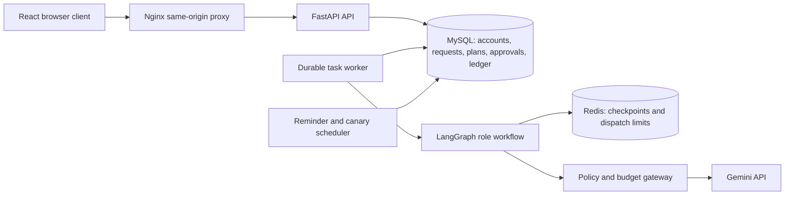

# Fitness Studio

A web application for confirmed member intake, versioned training and nutrition plans, and controlled AI operations. Members review proposed changes before activation. Owners manage service groups, approvals, budgets, incidents, and agent releases.

The interface and application text are English. Members can submit English or Chinese messages; AI replies are instructed to use English. Generated advice is general fitness guidance, not medical diagnosis or treatment.

## Run locally

Follow [Running Fitness Studio](docs/RUNNING.md) to configure the private environment and start the Docker services. The default browser entry point is **http://localhost:8088**. Model calls are disabled by default and require both server credentials and funded budget scopes.

## Member workflow

1. Register and complete intake. Review and confirm the extracted facts; deterministic rules decide admission or identify missing information and exclusions.
2. Request training, nutrition, or a coordinated plan. Candidates remain separate from active plans. Review any required approval, then explicitly activate the candidate.
3. Ask questions using **Chat** for training or **Nutrition questions** for nutrition. Questions use the appropriate role configuration and usable current plan; they do not modify plans.
4. Record actual experience, request a cycle review, or select a specific food portion to replace. Revisions are tied to their original input versions and cannot overwrite newer active plans.
5. Read in-app reminders and revisit profile details when circumstances change. A reminder never invents attendance or changes confirmed facts.

## Owner workflow

The owner workspace provides a review queue, operational overview, member groups, membership administration, budget limits, incidents, agent versions, and agent releases. Candidate configuration changes require explicit review and execution. Agent releases require recorded live comparison evidence and quality review; synthetic test evidence cannot authorize a release.

The overview supports an inclusive UTC date range and a downloadable Markdown operations brief, defaulting to the latest seven days. Both use the same metric service. Candidate creation and successful activation are counted separately. Period costs follow the creation time of model-call records and their current settlement state; current membership and incident totals are explicitly labelled as current state.

If an automatic rollback is blocked by a newer configuration, the affected role is blocked while it still uses the failed version and an incident is recorded. In Agent releases, propose recovery against the latest group version. Review the proposal in Review queue and execute it in Member groups. Only the affected role's retained version changes; other current settings remain intact. Configuration restoration alone does not close the incident: a subsequent successful request under the restored role is required for recovery verification.

## Architecture

- The API authenticates users and persists requests before execution. Session cookies and CSRF protection are used on one origin.
- Workers check current permissions, input versions, task leases, and immutable agent versions. The model proposes structured outputs; application services validate and commit changes.
- Training and nutrition candidates form an exact validated pair. Activation atomically updates current pointers. Historical versions remain available.
- Every paid dispatch needs a budget reservation and an application-wide rate permit. Unknown provider usage retains funds and is not reported as zero cost. Releasing an expired local concurrency slot does not reconcile billing or retry the original request.
- Structurally valid candidates that fail domain validation receive at most two corrective generations shared across the original request's roles. Each correction receives the failed candidate and recorded violations, uses the original deadline and budget scopes, and preserves invalid versions in history. Exhausting the revision or call limit stops the request without activation.
- The scheduler closes expired queued and waiting requests, expires pending approvals, recovers abandoned leases conservatively, and handles deterministic notifications and approved canary observation rules. Expiry preserves completed work and accounting evidence, including reservations for unknown provider usage. Missing observations cannot count as a successful release.
- Users can cancel their pending or running requests from a conversation or the Requests page, including cycle reviews awaiting confirmation. Cancellation fences task execution and blocks subsequent candidate activation. Already dispatched calls retain their accounting lifecycle; cancellation does not promise a provider refund or erase history. Completed requests cannot be cancelled.

## Source layout

| Path | Responsibility |
| --- | --- |
| `backend/app` | API, domain services, agent workflows, model transport, worker and scheduler |
| `backend/migrations` | Versioned MySQL schema |
| `backend/tests` | Domain, transport and persistence regression tests |
| `frontend/src` | English member and owner interfaces |
| `frontend/e2e` | Browser interaction tests; mocked cases are labelled |
| `scripts/test_backend.py` | Isolated backend test service startup and execution |
| `docs/RUNNING.md` | Environment, deployment and verification commands |

## Verification and scope boundaries

From an installed development environment, run `.venv/bin/python scripts/test_backend.py`. This starts separate MySQL and Redis test services, migrates the test database, and runs pytest with Gemini disabled and no API key. Test records stay separate from the application database. Browser fixture tests verify interaction behavior; they do not establish live model quality.

Build the frontend with `npm run build` from `frontend`. Browser tests require a running development web server and Chrome; use `npx playwright test` from that directory. Some browser tests exercise the API while others provide explicit synthetic responses.

The exercise and food catalogues are deliberately bounded; unsupported inputs must not be silently replaced with invented entries. The API readiness endpoint checks persistence connectivity and schema revision, not successful Gemini generation. A passing build or synthetic test suite is not a substitute for live end-to-end acceptance. Final deployment, live model acceptance, and release evidence must be verified separately.
