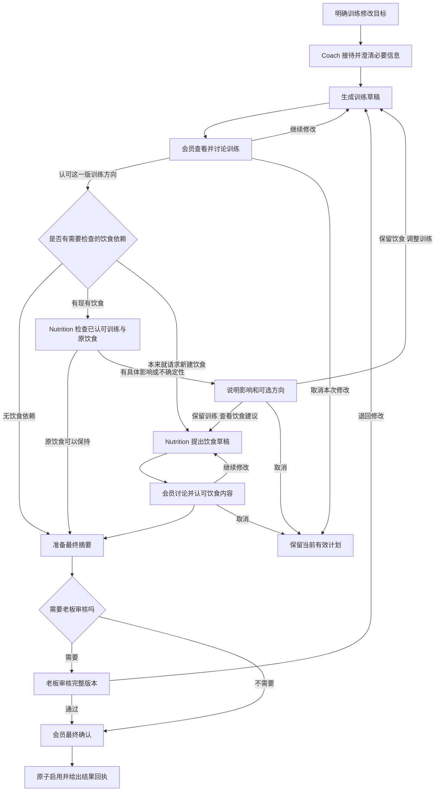

# Fitness Studio 渐进式协作交互：详细实施计划

- 日期：2026-10-30
- 状态：执行计划；已据此实施。实际采用方式与验收结果见 [实施验收记录](PROGRESSIVE_INTERACTION_ACCEPTANCE.md)。
- 上位需求：[渐进式交互整改需求](PROGRESSIVE_INTERACTION_REQUIREMENTS.md)
- 实施方式：按单人实施安排，不依赖团队分工。
- 语言：产品界面、代码、错误提示、按钮均使用英文；本说明使用中文；对话支持中英文。
- 技术方向：沿用现有 React/TypeScript 前端、Python 服务端、SQL 持久化、Redis/工作队列、版本化计划及审批体系。不更换模型供应商、不另建多个聊天应用。

## 1. 交付目标与范围

把当前“系统自动跑完多个专家，再让用户一次确认”的体验，改成“当前专家与用户讨论一个目标，认可具体方案后才进入下一个相关阶段”。

本次不仅覆盖训练修改，还覆盖饮食修改、首次组合建计划、周期复盘、食物替换、资料与入会审核、老板退回计划、额度阻塞、成员组变更、Agent 评估与发布、故障及未知费用等协作场景。

必须保留：

1. 一个连续的主对话和输入框。
2. Members、My plans、Review queue、AI usage & limits 等普通业务页面。
3. 当前有效计划直到合法最终确认才更新。
4. 原有预算预留、实际消费、调用计数、审计记录与所有权检查。
5. 老板 Updates、角标、具体详情入口和统一聊天操作。
6. 已有会话 Rename/Delete；未完成流程不能因删除会话而失去处理入口。

不在本次范围：新的模型调价、支付功能、医疗诊断能力、短信/邮件推送、重新设计整个品牌视觉。Sage Studio 样式继续使用。

## 2. 现状与改动依据

| 代码位置 | 已确认的现状 | 本次改动 |
|---|---|---|
| `frontend/src/ConversationView.tsx` | messages 与 requests 分段渲染；部分按钮跳 plans 总页 | 改为统一时间线；每阶段单一决策卡；所有 Review 有精确目标 |
| `backend/app/intent_router.py` | 查询、咨询、生成分支不同；规划委派不总更新接待角色；同一计划的后续修改可能被当成新任务冲突 | 增加活动流程上下文，区分继续讨论和新目标；按专业阶段切换接待角色 |
| `backend/app/coach_runtime.py` | coordinated 草稿成功后自动创建 Nutrition WorkItem | 先进入等待训练方向认可；明确认可后才创建 Nutrition 工作 |
| `backend/app/nutrition_runtime.py` | 已有训练优先的 Retain/SuggestChanges 检查，但触发过早 | 保留精确保留食谱、具体建议和校验逻辑；改变进入时机及后续阶段 |
| `backend/app/activation.py` | 已有精确配套、版本与审批校验 | 保留并补充阶段认可、基线依赖和最终确认检查 |
| `backend/app/member_experience.py` | 从任务状态推导业务状态 | 增加流程阶段投影，避免多个阶段都显示模糊的 Ready for review |
| `frontend/src/Plans.tsx` | 当前计划、草稿和历史在一页；部分配套入口靠锚点滚动 | 新增独立草稿详情路由，列表仍作为总览 |
| `backend/app/cycle_requests.py` | 是否有 nutrition 服务参与自动编排 | 权限只表示能力；阶段认可才允许进入后续检查 |
| `frontend/src/requestEvents.ts` | SSE 用于失效快照并去重，按 Request 终态关闭 | 保留快照失效机制；新增流程级事件，不能因某个子任务完成而漏掉后续阶段 |

其余模块按后文场景逐项复查，不把“需要统一检查”表述成已经证实有缺陷。

## 3. 五个概念必须分开

| 概念 | 用户理解 | 能否启用计划 |
|---|---|---|
| 目标 Goal | 我想把训练改简单一点 | 否 |
| 草稿 Draft | 专家提出的这一版具体方案 | 否 |
| 方向认可 Endorsement | 这版训练方向可以，继续检查下一步 | 否 |
| 老板审核 Owner review | 工作室允许提供这版方案 | 否，不能代替会员接受 |
| 最终确认 Activation | 我接受最终内容，开始使用 | 满足所有规则后才可以 |

阅读、打开详情、关闭弹窗、普通聊天中的模糊“OK”，均不自动构成最终启用。

## 4. 主流程：训练先讨论，再进入饮食阶段

图中“老板退回”返回哪个专家由实际受影响内容决定，不固定回 Coach：只改饮食则回 Nutrition；两边受影响则重新检查依赖。

### 4.1 阶段文案与操作

| 阶段 | 当前角色 | 用户能看到 | 主要操作 |
|---|---|---|---|
| 目标澄清 | Coach | 对原始目标的简短理解及必要问题 | 自由输入回答 |
| 生成训练 | Coach | `Preparing your training draft…` | `Cancel update` |
| 讨论训练 | Coach | 主要变化、时长、草稿摘要；明确尚未启用 | `View training draft`、`Continue with this training`；直接输入修改意见 |
| 饮食检查 | Nutrition | `Checking your current meals against this training draft…` | 等待或取消，不提前展示后续所有选项 |
| 无需改饮食 | Nutrition | `Your meals can stay the same.` 加简短理由 | 查看最终摘要 |
| 有饮食影响 | Nutrition | 具体影响、证据限度、建议；避免冗长免责声明淹没操作 | `Review meal suggestions` 或 `Keep meals · Revisit training` |
| 讨论饮食 | Nutrition | 改哪些餐次/份量以及原因 | `View meal draft`、`Continue with these meals`；直接输入修改意见 |
| 待老板审核 | 对应专家/系统状态 | `Waiting for studio review` | 查看已提交版本或取消；不能重复申请同一版本 |
| 待最终确认 | 当前专业角色，卡片统一展示 | 完整变化与保留内容 | `Confirm update`、`Request changes`、`Cancel update` |
| 已启用 | 系统回执 | `Your updated routine is now in use.` | `View current plans` |

`Continue with this training` 下方固定解释：`This approves the draft direction, not activation. Next, we’ll check your meals if needed.`

“保留哪一边”必须明确对象：是保留当前有效饮食，还是已讨论认可的饮食草稿；按钮旁显示版本摘要，不使用模糊的 Keep。

### 4.2 没有饮食依赖时

- 账号只使用训练服务、没有关联饮食：认可训练后直接进入必要审核与最终确认，不制造 Nutrition 阶段。
- 没有现有食谱、用户只要求训练：不自行增加“创建饮食”。
- 用户明确请求首次训练和饮食：先认可训练，再创建饮食草稿。
- 存在关联食谱但营养服务权限被撤销：不得绕过检查或静默清空食谱。显示具体阻塞和老板处理入口，保持原有效状态，按现有服务规则决定可用性。

## 5. 其余场景的逐项流程与边界

### S01 查询、解释与深入咨询

例：`What is my training plan for today?` / `Explain this meal.`

当前角色读取有权限的有效记录直接回答。无日历数据时不能虚构“今天预约”。读取不生成草稿、不增加修改任务、不改变生效计划。

用户明确要求深入讨论训练时转 Coach；问一句通用训练知识不必转接。没有可访问计划时明确说明并给创建入口，不从旧消息重建“当前计划”。

### S02 训练修改

例：`Make my training easier and keep each session within 30 minutes.`

执行第 4 节。用户后续说 `Remove one exercise.` 归入当前训练草稿修订；不能报“已有另一个更新，请取消后再试”。新版本取代旧草稿的可操作性，保留旧内容用于历史比较。

### S03 首次训练＋饮食

例：`Help me build a training and meal routine.`

前台收集资料 → 会员确认资料 → 必要入会审核 → Coach 草稿与讨论 → 认可训练 → Nutrition 草稿与讨论 → 必要计划审核 → 最终确认。

批准入会只恢复原目标的下一合法步骤；不自动生成和启用全套计划。未完成入会期间可以一般性咨询，但不能暗中跳过资格条件。

### S04 修改饮食并可能影响训练

例：`Change my meal plan to include more vegetarian options.`

Nutrition 先明确是否涉及新的饮食限制；确认资料后提出饮食草稿，用户讨论并认可。随后检查与当前训练的依赖。

- 没有训练影响：不强制叫 Coach 出新训练。
- 有具体影响：先说明，再询问保留饮食草稿调整训练，还是保留当前训练重新调整饮食。
- 后续训练有变化：必须由会员认可训练新版本，不能继承旧训练认可。
- 最终依然使用匹配版本原子生效；不存在训练的账号保留独立饮食流程。

### S05 替换一道菜或一种食物

例：`Replace the oats in my breakfast.`

明确当前食谱、餐次、份量 → 展示受支持替换 → 用户确认 → 校验 → 更新对应食谱版本。

不扩大成整套计划生成，不启动不必要的 Coach。若替换涉及新过敏信息，先更新资料；无符合条件替换时给明确结果和继续修改条件的入口，不虚构替换成功。

已足够具体的一步替换使用一次最终确认，不强行加入“认可方向＋认可草稿＋再确认”的三层操作。

### S06 训练周期复盘

例：`Review my last training cycle and make the next one easier.`

先展示已记录反馈，用户补充或确认 → Coach 生成下一周期草稿 → 讨论并认可 → 必要饮食依赖检查 → 审核与最终确认。

实际完成情况只能来自用户确认的数据。确认反馈不等于认可下一周期；不能因为 membership 含 nutrition 权限就直接生成食谱。

### S07 新伤情、资料变化

例：`My knee hurts now. Can you change my exercises?`

当前专家识别影响 → 前台收集并确认相关资料 → 必要老板审核或服务范围处理 → 返回原始目标。

暂停受影响流程并记录原因，不把新资料自动当成已确认。新的资料版本使旧校验失效。无需重新问已确认的全部资料，但要说明哪些草稿需要重新计算。不能承诺医疗诊断或仅凭老板点击就恢复不适用服务。

### S08 入会申请与老板审批

前台整理资料 → 会员确认提交 → 会员收到 `Submitted · Waiting for studio review` → 老板 Updates 收到具体申请 → 老板决定 → 两端更新。

简单审批可在老板聊天/Updates 内弹窗完成；复杂证据打开准确详情。多人同时审核时第一个有效决定生效，其他界面显示已处理。会员不能通过聊天代替老板审批；老板不能替会员确认资料真实。

### S09 老板退回计划

老板明确退回对象、原因和具体版本 → 对应专家修订 → 会员重新查看受影响内容 → 必要依赖检查 → 重新提交审核 → 会员最终启用。

必须区分 `Request changes` 与最终 `Rejected`。退回不是静默生成并启用替代版本；驳回不能表现为永久加载。

只调整饮食时保留未变化且依赖仍有效的训练认可；如果训练因此需要变化，失效训练认可并明确解释。老板只批准精确版本，不批准未来所有修改。

### S10 额度、预算与服务容量阻塞

当前阶段显示原因 → 需要老板处理的事项进入 Updates → 老板调整额度或预算 → 服务端重新检查 → 继续原来已获授权的步骤。

- `Awaiting training endorsement` 不是容量阻塞，不能因充值被恢复为 Nutrition 工作。
- 容量恢复不能跳过方向认可、老板审批或最终确认。
- 原草稿/资料过期时显示需要复查，不盲目重试。
- 额度调整不重置历史调用或消费；同一阻塞去重；多个独立阻塞逐项说明。
- 个人日额度/滚动小时自然恢复可进入 Monitoring，不要求老板无意义地逐条确认。

### S11 老板修改额度、成员组与配置

例：`Give Alice 300 calls per day.`

解析对象 → 重名时只澄清对象 → 展示当前值、来源和影响 → 明确确认 → 调用现有业务服务 → 当前卡显示回执、Updates 同步。

聊天、弹窗、业务子页面使用同一服务。明确调用次数和金额是不同限制。换组时说明个人额度例外是否保留、哪些服务权限改变；不自动清零使用量，也不把换组视为会员认可新计划。

需要审批的配置继续保留“提出变更→审核→执行”三个概念。对于已经授权且规则允许直接保存的简单限额，不额外强加发布流程。

### S12 Agent 评估与发布

创建候选 → 运行评估 → 展示结果与限制 → 人工质量评审 → 发布审批 → 执行发布 → 展示部署结果与回退入口。

评估完成不等于发布；通过审批不等于已经部署。多步骤以当前阶段卡呈现，完整日志在详情。后台 Technical Manager 不可通过模型文本越权批准或发布。模型配置修改后，未执行工作重新检查绑定版本；已经运行的工作保持其原始执行证据，不混写版本。

### S13 故障、未知费用与恢复

同一来源问题合并提醒，清楚显示可做的决定及其效果。

- 知悉归档：退出待办，保留 Monitoring 和预留资金。
- 释放本地槽位：只释放本地容量，不伪造服务商结算。
- 请求恢复：只恢复满足条件的原步骤。
- 关闭未解决故障：记录未解决结果，不宣称业务成功。

本次统一其展示、路由、回执与阶段恢复约束；不把尚未建设的费用核实入口描述为已有能力，也不新增未经定义的自动退款。

## 6. 意图识别、继续讨论和角色交接

### 6.1 意图上下文

路由器必须接收：当前流程ID、目标、阶段、当前角色、最新草稿ID/版本、已认可版本、待确认动作、原始基线和最近明确的用户约束。

返回结构至少区分：

| 意图 | 行为 |
|---|---|
| Read / Explain | 当前角色回答，不改阶段 |
| DiscussCurrentDraft | 当前专家解释当前草稿，不重新生成 |
| ReviseCurrentDraft | 对当前草稿创建下一版，作废相关认可 |
| EndorseDirection | 只有明确指向当前版本时才能推进阶段 |
| NewGoal | 判断是否与已有写入流程冲突，给具体入口 |
| SwitchTopic | 回答插入问题，保存原流程位置 |
| CancelFlow | 明确取消目标；多目标歧义时先问是哪一项 |
| FinalActivationIntent | 展示当前最终摘要和确认按钮，不能由模型直接启用 |
| OwnerDecisionIntent | 解析对象与动作，使用老板权限服务及确认卡 |

“可以”“好的”等短回复只有在唯一、紧邻、未失效的明确阶段问题下可解释为方向认可；否则询问具体意图。第一版最终启用一律走明确确认按钮，不把自由文本解释为最终签字。

### 6.2 会话角色规则

- 执行角色、当前接待角色、决策人是三个字段，不混用。
- 明确进入训练修改：接待角色为 Coach；饮食阶段才改为 Nutrition。
- 只读查询和后台校验不造成可见角色跳转。
- 老板端仍由 Technical Manager 接待，后台调用其他能力不创建多个聊天框。
- 前台资料处理完成后回到保存的目标与角色，不让用户重说。
- 迟到的旧路由结果不能覆盖用户后来的选择，需校验会话/流程版本。

## 7. 持久化状态与数据模型计划

以下是拟新增设计，不是现有接口或表。

### 7.1 Flow：用户目标层

新增 `Workflow` 或等价表，包含：

- `id`, `user_id`, `conversation_id`, `goal_kind`, `original_goal`。
- `stage`, `lifecycle_status`, `revision`（乐观并发版本）。
- `host_role`, `primary_domain`, `return_stage`, `resume_stage`。
- 当前训练/饮食草稿ID与认可记录引用。
- `baseline_current_version`、当前有效训练/饮食ID、资料/配置版本。
- `blocked_reason`、`next_actor`、`created_at`、`updated_at`、`expires_at`。
- 当前账户和计划资源的冲突范围。

Flow 表示一个用户目标；Request/WorkItem 继续表示一次执行及工作项。通过外键关联，不把所有新阶段硬塞进旧的 Request.status。保留 Request 调用上限及账户/模型限额；为 Flow 增加累计调用和修订边界，避免每次创建新子任务就绕过旧上限。

### 7.2 Stage 与运行状态分离

业务阶段建议：

`Clarifying` → `TrainingDiscussion` → `MealImpactReview` → `MealDiscussion` → `OwnerReview` → `FinalReview` → `Completed`。

按场景可以跳过不适用阶段或返回前一阶段。单独保存运行状态：`Idle / Generating / AwaitingMember / AwaitingOwner / Blocked / Cancelled / Expired / Completed`。

例如：`TrainingDiscussion + AwaitingMember` 不等于 `MealImpactReview + Blocked`，不能用同一个 Waiting 恢复规则处理。

### 7.3 Endorsement：精确方向认可

记录 `flow_id`, `actor_id`, `domain`, `draft_id`, `draft_fingerprint`, `dependency_fingerprint`, `created_at`, `invalidated_at`, `invalidated_reason`。

唯一有效认可绑定一个精确内容和依赖组合。实质性变更必须失效；与内容无关的会话改名不应导致失效。老板审批继续使用现有 Approval，不借用会员认可表。

### 7.4 事件与时间线

新增流程事件和对话时间线投影，至少包含：稳定事件ID、会话内单调序号、流程ID、来源消息/请求ID、事件类型、可见角色、目标记录、卡片状态与版本。

- 事件不可因轮询重复追加。
- 全局排序使用序号，不仅使用可能相同的时间戳。
- 同一阶段进度通过 card ID + revision 更新；阶段完成/决策回执作为新的事件追加。
- 原始消息、审计和技术事件保留；前端只接收允许展示的业务投影。
- 已有历史的顺序无法精确恢复时保持稳定的推导顺序，并在迁移说明中承认边界，不制造虚假的时间证据。

## 8. 服务端转换规则与事务边界

新增集中式 workflow service；聊天、页面、Updates、恢复任务均调用同一转换函数。

每个动作验证顺序：

1. 登录、对象归属、角色权限。
2. 幂等键及动作载荷摘要。
3. 流程当前 revision 和目标草稿指纹。
4. 基线、资料、配置、依赖版本及有效期。
5. 当前阶段是否允许该动作，是否已取消或被替代。
6. 在事务内写认可/阶段/审计，并创建唯一后续工作或可靠 outbox 事件。
7. 返回最新流程快照、时间线游标和业务回执。

关键转换：

| 动作 | 前置条件 | 结果 | 不允许 |
|---|---|---|---|
| Revise training | 当前有效训练讨论阶段 | 新训练草稿版本，保持原目标 | 同时自动生成饮食 |
| Endorse training | 精确最新训练草稿有效 | 保存认可，按依赖进入检查或最终阶段 | 提前更新 CurrentPlans |
| Keep meals / revisit training | 有具体饮食影响结果 | 带饮食约束回 Coach，失效受影响训练认可 | 沿用旧认可自动进入检查 |
| Endorse meals | 最新饮食版本有效 | 必要依赖复核/老板审核/最终摘要 | 修改训练而不让会员重看 |
| Owner approve | 老板拥有该审批权限且版本未变 | 记录审核结果并通知会员 | 替会员启用 |
| Confirm update | 所有必需认可、校验、审批有效 | 原子更新当前计划、完成流程 | 只更新一半配套计划 |
| Resume blocked | 原步骤已经获得授权，阻塞已解除 | 继续同一步 | 把等待人工决定当成待运行任务 |

锁顺序在实现时统一为成员/资源锁 → Flow → Request/WorkItem → 具体版本/审批，审计已有调用链后统一，避免端点各自反向加锁。队列发布应在事务提交后通过幂等 outbox 或现有可靠机制执行。

## 9. API 与深链接计划

拟新增或扩展接口（名称可在实现时按项目规范调整，语义必须保留）：

| 接口 | 用途 |
|---|---|
| `GET /api/conversations/{id}/timeline?after=…` | 返回业务时间线、游标与分页信息 |
| `GET /api/me/workflows/{id}` | 当前阶段、版本、下一步、允许动作 |
| `POST /api/me/workflows/{id}/actions` | 提交阶段决定/修订/取消，统一并发和幂等检查 |
| `GET /api/me/plan-drafts/{id}` | 精确草稿、差异、权限及所属流程 |
| `GET /api/me/plan-pairs/{id}` | 最终配套摘要与确认资格 |
| 现有老板接口 | 保留真正执行服务；由统一阶段服务做协调，不复制权限逻辑 |

动作载荷至少有 `operation_key`, `action`, `expected_flow_revision`, `target_id`, `target_fingerprint`；修订动作另有文本反馈。客户端传来的 role 或 allowed_actions 不能作为授权依据。

深链接建议分别指向训练草稿、饮食草稿、配套确认和审批详情；统一目标包含对象ID、版本、来源对话与返回位置。刷新、复制链接、浏览器前进后退均可恢复。

返回 409 时携带可公开的冲突原因和最新版本目标；403/404 不泄露其他会员的信息；失效目标不能静默回退到食谱总页。

## 10. 前端组件与视觉行为

### 10.1 主对话

拆分 `ConversationView` 中的混合逻辑，拟新增：

- `ConversationTimeline`：按序渲染业务事件。
- `WorkflowStageCard`：当前目标、专家、简短摘要、单一主动作。
- `DraftPreviewCard`：训练/饮食核心内容和差异摘要。
- `DecisionReceipt`：显示谁在何时确认了哪一版，以及结果。
- `NewUpdatesIndicator`：翻阅历史时提供回到底部入口。

保留底部输入框。标题仅为 `Your fitness assistant`；角色用头像、图标与 `With Coach` 等轻量标签表达。

### 10.2 草稿详情

桌面使用独立路由支持的详情面板或抽屉；窄屏使用全宽详情。标题包括类型、Draft 标签、版本；显示相对于当前有效计划和上一草稿的区别。

用户可在详情里输入修改意见，也可返回聊天继续。二者修改同一流程，不创建第二套草稿状态。组合最终确认只有在两边都具备条件时出现。

### 10.3 历史与当前操作

旧卡片只显示历史状态和最新版本入口。已完成计划在原位置显示完成回执，不因每次轮询重新排到最底部。

用户插入无关问题后，回答正常追加；如原流程仍待决定，底部可显示一条简短 `Continue your training draft` 入口，不复制整个旧决策卡。

### 10.4 可用性

所有动作有 loading、成功、失败反馈；错误出现在相关卡片/弹窗附近。键盘可操作，焦点返回合理；状态不能只靠颜色区分。动画用于进度和切换，支持 reduced motion；不以动画掩盖没有后端状态的等待。

## 11. 场景间交叉与异常处理矩阵

| 交叉/异常 | 必须处理的方式 |
|---|---|
| 训练讨论中问营养知识 | 可以回答，只读咨询不推进饮食阶段；提供返回训练入口 |
| 训练讨论中明确要求同时修改饮食 | 记录扩展目标，但先完成当前训练认可；若用户要先谈饮食，明确切换主域并保存训练草稿 |
| 原目标临时搁置 | 保留草稿和阶段，不继续后台生成；过期后明确重新评估 |
| 同一会话两项待决策 | 操作卡带对象；模糊“确认”不能任选其一 |
| 不同会话修改同一当前计划 | 导向现有写入流程，允许继续或明确取消替代；禁止静默覆盖 |
| 不同会话只读查询 | 不与修改流程冲突；显示当前有效版本，不冒充草稿已生效 |
| 双标签页确认同一版本 | 幂等返回同一结果；第二个不同动作按 revision 拒绝 |
| 认可后修改草稿 | 使相关认可失效；后续结果标为过时，不复用 |
| 检查期间改资料 | 提交结果时再验资料版本；迟到结果不能发布成有效方案 |
| 最终摘要打开后当前计划被替换 | 激活拒绝并指向最新状态；不能用客户端旧摘要强行启用 |
| 老板退回时会员正准备确认 | 服务端拒绝旧确认；会员看到退回原因与修订状态 |
| 容量恢复但会员尚未认可训练 | 仍停留训练讨论，Nutrition 不运行 |
| 取消时模型已发送 | 不应用迟到结果；用量按真实结果记录，不伪称退款 |
| 取消时已最终启用 | 不能把取消当回滚；说明已经启用，需发起新的修改流程 |
| 达到调用/修订边界 | 保留最后有效草稿，明确暂停原因；不能每次新建 Request 绕过 Flow 总上限 |
| 模型给出冲突或不确定结论 | 展示限制与可行选择，不强迫用户决定专业事实；无法支持则保持原计划 |
| 会话删除 | 有未完成 Flow 时拒绝并给精确任务入口；无未完成流程时软删除会话，业务记录保留 |
| 已删除会话的审批或计划历史 | 仍可从业务详情访问有权限的必要记录；不能恢复为可聊天会话或报无意义空白 |
| SSE 断线/重复/乱序 | 使用游标和最新快照恢复；不重复生成、收费或追加卡片 |
| 服务重启 | 从持久阶段恢复；等待人工决定的流程保持等待 |

## 12. 老板 Updates 与会员通知的对应规则

| 事件 | 老板看到 | 会员看到 |
|---|---|---|
| 会员认可训练 | 通常不新增老板待办 | 已认可方向，进入必要检查 |
| 完整方案需老板审核 | 一个具体版本的审核事项 | Waiting for studio review |
| 老板批准 | 当前事项完成，回执保留 | Ready for your confirmation |
| 老板要求修改 | 审核事项进入相应已处理/待新版本状态 | 原因、负责专家、修订进度 |
| 预算阻塞 | 按实际作用域合并的可操作提醒 | 暂停原因和下一步，不显示内部费用单位 |
| 阻塞消除 | 提醒按真实状态解决或进入监控 | 原授权步骤恢复；不会跨过人工门槛 |
| 最终启用 | 通常只记录结果，不制造新待办 | 最新完成回执和有效计划入口 |

`Needs action` 只统计有当前可执行决定的事项；等待会员不冒充老板待办；已读、已归档、已解决保持不同含义。详情、聊天和 Updates 使用同一个动作服务及最新状态。

## 13. 数据迁移与旧流程兼容

采用增量迁移，不删除现有消息、计划、账目或审批。

1. 备份当前数据库并记录迁移前计数、当前计划指针和未完成任务快照。
2. 新表/新字段先上线，默认兼容旧请求；用版本标识区分 legacy 与 progressive 流程。
3. 已完成旧任务保持历史，不重新触发专家、收费或要求重新确认已经生效的计划。
4. 旧未启用组合草稿：展示已有内容，要求会员认可训练方向；不得将旧的“Review”点击推断成认可。
5. 旧任务正在运行：暂停新增后续派发；已经发送的结果可保存为待审草稿，但不能自动越过新门槛；清楚显示为历史生成结果。
6. 迁移中的未知费用、预留和进行中的模型调用不强行清算；旧事件ID建立映射，避免重复通知。
7. 旧通用 Review 链接能确定对象时重定向具体详情；无法确定时显示明确选择列表，而不是默认打开第一份食谱。
8. 回滚以关闭新流程创建和恢复兼容读取为主；已有 progressive 流程不得落回会自动派发下一专家的旧逻辑。不能删除新表后丢失用户认可证据。

上线期间需要短暂控制工作派发，确保没有新旧调度器同时接管同一流程；实际部署方案在实现前根据运行任务快照确定。

## 14. 单人实施批次、依赖与交付物

| 批次 | 工作内容 | 主要落点 | 完成条件 |
|---|---|---|---|
| P0-1 | 冻结状态、动作、权限和目标契约；编写关键失败用例 | 新 workflow 契约、测试夹具 | 训练未认可时无 Nutrition 工作的测试先建立 |
| P0-2 | 数据模型、迁移、阶段转换、幂等与事件 | `models.py`、migrations、新 workflow service | 重启/连点/并发不跨阶段，旧数据可读取 |
| P0-3 | 意图路由、接待角色、同目标多轮修订 | `intent_router.py`、`planning_context.py`、`chat.py` | 连续修改同一草稿不触发新任务冲突 |
| P0-4 | Coach 停点、认可入口、Nutrition 检查与最终启用 | `coach_runtime.py`、`nutrition_runtime.py`、`activation.py` | 完成训练优先全链路，两边不提前生效 |
| P0-5 | 统一时间线、角色提示、精准草稿详情 | `ConversationView.tsx`、`Plans.tsx`、`ownerNavigation.ts`、`requestEvents.ts` | 最新结果位置正确，所有 Review 定位准确 |
| P1-1 | 首次组合、饮食优先、周期复盘、替换项接入 | `cycle_requests.py`、`substitution.py`、相关前端 | 各场景只经过必要阶段，不滥用全流程 |
| P1-2 | 资料变更、老板退回、审批和双端通知 | admission/intake 路径、`plan_review.py`、`owner_updates.py`、`notifications.py` | 认可失效、审批完成、会员确认彼此区分 |
| P1-3 | 老板配置、额度、发布、恢复流程统一投影 | `group_configuration.py`、`agent_release.py`、evaluation/usage/recovery 路径、老板卡片 | 沿用原权限服务，当前可做决定清晰 |
| P2 | 旧任务迁移、完整回归、真实浏览器验收、部署 | 迁移脚本、验收文档、部署配置 | 无数据丢失，证据与限制明确，GitHub 与验收环境一致 |

实施顺序按依赖推进，不在每完成几个测试后暂停。真正阻塞范围、需要新外发授权或不可逆数据操作时才提出具体问题；一般实现选择按本文执行。

## 15. 验收矩阵与证据要求

| ID | 场景/操作 | 必须观察到的结果 |
|---|---|---|
| A01 | 在 Nutrition 对话输入训练修改 | 主持角色变 Coach，保留原目标，无重复提问 |
| A02 | 只问训练安排 | 当前角色回答，无新草稿、无角色乱跳 |
| A03 | Coach 完成训练草稿但会员未认可 | Nutrition 工作数和调用数均为零 |
| A04 | 连续提出三次训练修改 | 同一 Flow 三个版本，只有最新版可认可 |
| A05 | 点击认可、重复点击、刷新 | 只产生一次合法下一阶段工作 |
| A06 | 饮食无需变化 | 原食谱餐次、食物和份量保持；新关联版本不冒充新食谱内容 |
| A07 | 有饮食影响，选择保留训练 | Nutrition 展示具体建议，会员可多轮调整后再认可 |
| A08 | 有饮食影响，选择保留饮食 | Coach 获得明确饮食约束，旧认可失效，需再次认可训练 |
| A09 | 两边调整后最终确认 | 两份匹配版本原子启用；每次之前 CurrentPlans 不变 |
| A10 | 首次仅训练/仅饮食/两者 | 分别走最短合法流程，不凭权限扩大范围 |
| A11 | 替换一份食物 | 只修改选定范围，不能无提示重做训练或其他餐次 |
| A12 | 周期反馈确认 | 不等于下一周期计划认可，不提前启动 Nutrition |
| A13 | 新伤情/限制 | 进入资料确认，相关旧草稿与审核失效 |
| A14 | 老板批准/退回/多人同时审核 | 正确版本决定生效，会员页面与 Updates 同步 |
| A15 | 增加预算恢复 | 只恢复原授权执行步骤，不能代替会员方向认可 |
| A16 | 取消生成与迟到结果 | 结果不能激活，不篡改用量账目 |
| A17 | 过期、双会话写入、陈旧确认 | 拒绝并提供准确继续入口，不覆盖新状态 |
| A18 | 全部 Review 入口、直接链接、前进后退 | 精确草稿/配套/审核详情，错误对象不会默认显示食谱 |
| A19 | 长历史与新结果 | 时间线从旧到新，旧任务不压在最新结果后；读历史不抢滚动 |
| A20 | SSE 断线重连和服务重启 | 恢复同阶段，无重复卡片或模型调用 |
| A21 | 会员伪造老板动作/其他会员ID | 服务端拒绝，界面不泄露私有记录 |
| A22 | Rename/Delete 与未完成 Flow | 改名不失效认可；删除不能绕过未完成任务限制 |
| A23 | 老板额度/成员组/发布/故障 | 对象清楚、阶段清楚、简单动作就地处理、复杂动作精确跳转 |
| A24 | 旧数据迁移 | 有效计划、预算和用量不改变；不凭旧按钮点击补造认可 |

测试分层：

- 单元：阶段转换表、认可失效规则、目标解析、事件排序、结构化内容差异。
- 集成：真实隔离数据库/Redis，模拟模型输出，检查事务与禁止派发边界。
- 浏览器：会员/老板双账号，桌面与窄屏，键盘操作、滚动、刷新、深链接、跨页返回。
- 故障注入：重复消息、超时、任务取消、过期、版本变更、审批竞争、迟到结果。
- 真实模型小样本：单独记录供应商、模型、调用数、费用、样本限制；优先使用演示数据，遵守现有外发授权范围。模拟通过不能宣称真实模型判断已验证。

关键自动化断言必须检查“没有发生什么”：未认可训练时没有 Nutrition 调用；未最终确认时没有 CurrentPlans 更新；取消后没有激活；查看页面不触发模型生成。

## 16. 最终交付与上线完成标准

交付：代码、增量迁移与兼容策略、场景测试、浏览器验收证据、更新后的会员/老板测试说明、GitHub 提交和可访问验收链接。

验收报告逐项注明通过、未通过、未验证，不用仅构建成功代替流程验收。明确展示真实模型测试与模拟测试的区别。

上线前核对：新流程创建受控、旧流程不自动越过人工门槛、服务可用、前后端版本一致、数据库迁移完成、当前计划与账目核对、老板/会员页面都可进入。

成功标准：用户每一步都知道当前在讨论什么、谁在负责、自己确认了哪一版、下一步是什么；任何后台自动化都不能越过尚未作出的业务决定。

## 17. 实施中确定的兼容方式

为避免批量改变历史运行任务，本次采用按对象显式接入：旧草稿详情提供 `Discuss this saved draft step by step`。仅会员选择的、没有未完成工作的有效草稿可以接入新阶段；不会在启动时扫描并作废排队任务或老板审批。历史已生效计划不改变。

新增流程复用原 Request/WorkItem 作为有界执行容器，以 Workflow 表存储业务阶段、精确认可、基线和反馈；同一目标的修订不重置原调用上限或截止时间。数据库工作队列的事务写入继续作为可靠派发机制，不额外引入外部队列。
