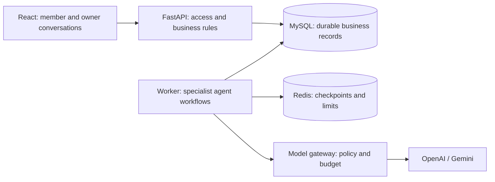

# Fitness Studio｜小组安装与演示手册

中文操作说明 · 英文演示输入与推荐口播 · 12 分钟团队演示

## 一、从 GitHub 下载并运行

### 1. 下载项目

1. 打开 [Fitness Studio GitHub 仓库](https://github.com/franckwei29/fitness-studio)，选择 **main** 分支。
2. 点击 **Code → Download ZIP**，下载后完整解压，进入 `fitness-studio-main` 文件夹。
3. 确认文件夹包含 `compose.yaml`、`compose.app.yaml`、`.env.example`、`backend` 和 `frontend`。
4. 使用 VS Code 或 IntelliJ 打开该文件夹，再打开其 Terminal。也可以在系统终端进入该目录。所有后续命令均在这个项目根目录执行，不需要创建 Java 项目或单独安装 Python、Node.js、MySQL。

### 2. macOS 安装

1. 在“关于本机”查看芯片类型，从 [Docker 官方 Mac 安装页](https://docs.docker.com/desktop/setup/install/mac-install/)下载 Apple Silicon 或 Intel 对应版本。
2. 打开安装文件，将 Docker 拖入 Applications，再启动 Docker Desktop，按提示完成初始化，等待引擎运行。
3. 在项目终端执行：

```bash
docker version
docker compose version
ls compose.yaml compose.app.yaml .env.example
```

`docker version` 应同时显示 Client 和 Server。首次创建配置：

```bash
if [ ! -f .env ]; then cp .env.example .env; fi
```

在编辑器打开 `.env`。Finder 中可用 `Command + Shift + .` 显示隐藏文件。

### 3. Windows 安装

1. 按 [Docker 官方 Windows 安装页](https://docs.docker.com/desktop/setup/install/windows-install/)核对系统和硬件支持，使用 WSL 2 后端。
2. 尚未安装 WSL 时，以管理员身份打开 PowerShell，执行以下命令，按提示重启：

```powershell
wsl --install
```

3. 打开 PowerShell 更新并检查 WSL：

```powershell
wsl --update
wsl --set-default-version 2
wsl --version
```

4. 从上述官方页面下载适合电脑架构的 Docker Desktop，安装并启动，使用 **Linux containers**，等待引擎运行。
5. 在项目文件夹打开 PowerShell，执行：

```powershell
docker version
docker compose version
Get-Item compose.yaml, compose.app.yaml, .env.example
if (-not (Test-Path .env)) { Copy-Item .env.example .env }
```

在编辑器打开 `.env`，确保文件名不是 `.env.txt`。

### 4. 填写本地配置

保留 `.env.example` 的其他设置，修改以下项目。下表占位内容需要替换为实际值；模型凭据由各自服务商账号或团队负责人提供，不写入共享文档或提交到 GitHub。

| 配置项 | 填写内容 |
|---|---|
| `DATABASE_PASSWORD` | 自行生成的数据库密码，建议至少 24 位字母、数字、`-`、`_` |
| `DATABASE_ROOT_PASSWORD` | 另一组独立数据库密码 |
| `DATABASE_URL` | 将模板 URL 中的密码替换为与 `DATABASE_PASSWORD` 相同的值 |
| `SESSION_SECRET` | 独立随机字符串，建议至少 32 位 |
| `OWNER_EMAIL` | 本机老板账号邮箱 |
| `OWNER_PASSWORD` | 本机老板账号密码，至少 10 位 |
| `MODEL_PROVIDER` | `openai` |
| `OPENAI_MODEL` | `gpt-6-luna` |
| `OPENAI_API_KEY` | 实际可用的 OpenAI API Key |
| `GEMINI_MODEL` | `gemini-3.5-flash-lite` |
| `GEMINI_API_KEY` | 实际可用的 Gemini API Key，模型对比需要 |
| `MODEL_CALLS_ENABLED` | `true` |
| `MODEL_HOURLY_CALL_LIMIT` | 首次初始化建议保留 `100` |
| `MODEL_ACCOUNT_DAILY_CALL_LIMIT` | 首次初始化建议保留 `200` |
| `COOKIE_SECURE` | 本地 HTTP 使用 `false` |

模型名来自本项目当前支持目录，实际可用性取决于凭据和服务商权限。已有账号不会因为修改 `.env` 的老板密码而重置密码；已有调用额度通过网页修改。

### 5. 构建、启动与检查

Mac Terminal 和 Windows PowerShell 均执行：

```text
docker compose -f compose.yaml -f compose.app.yaml up --build -d
docker compose -f compose.yaml -f compose.app.yaml ps -a
```

正常状态：`initialize` 为 **Exited (0)**；MySQL、Redis、API 健康；web、worker、scheduler 正在运行。

- 检查服务：[http://localhost:8088/health/ready](http://localhost:8088/health/ready)，应返回 ready 状态。
- 打开应用：[http://localhost:8088](http://localhost:8088)。这是新安装的默认地址。
- 使用 `.env` 中的老板账号登录。

### 6. 登录与开始使用

1. 打开 `http://localhost:8088`，使用配置文件中的老板账号登录。
2. 保持老板窗口；另开无痕窗口访问同一地址，点击 **New here? Create an account**，注册 `Alex Demo`。推荐邮箱 `alex.demo@example.test`，本地演示密码 `AlexDemo-Local2026!`。
3. 按下方 Victor 演示步骤完成资料确认，入会后可直接继续训练与饮食规划。
4. 多人分配演示可再注册 `Jamie Demo`，推荐邮箱 `jamie.demo@example.test`，本地演示密码 `JamieDemo-Local2026!`，同样完成入会。
5. 使用彩排会员测试聊天：

```text
In one short sentence, explain how you can help with my fitness routine. Do not create or change any plans.
```

收到正常回复后，按演示顺序进行彩排。

### 7. 常用命令

启动或重新构建：

```text
docker compose -f compose.yaml -f compose.app.yaml up --build -d
```

停止并保留数据：

```text
docker compose -f compose.yaml -f compose.app.yaml stop
```

排查启动或聊天异常：

```text
docker compose -f compose.yaml -f compose.app.yaml ps -a
docker compose -f compose.yaml -f compose.app.yaml logs --tail=100 initialize api worker scheduler
```

Docker 命令无法连接时先启动 Docker Desktop；网页能打开但聊天不能执行时，检查模型凭据、调用开关、适用预算和 worker 状态。8088 被占用时可在 `.env` 增加 `WEB_PORT=8089`，重新启动并使用新端口。

## 二、演示准备与前十分钟推荐安排

### 1. 故事与时间

**会员提出目标 → 确认资料 → 认可训练 → 确认配套饮食 → 老板比较和试用模型 → 查询实际服务并控制用量。**

| 时间 | 同学 | 推荐展示重点 |
|---|---|---|
| 00:00–02:00 | Victor | 项目背景、Intake 资料提取与本人确认 |
| 02:00–04:00 | Oliver / Aowei | 受约束训练草稿、内容展示与方向认可 |
| 04:00–06:00 | Renee / Shu-Chi | 配套饮食、营养计算与最终启用 |
| 06:00–08:00 | Yuankang / 元康 | 模型比较、老板确认发布与多人分组 |
| 08:00–10:00 | Haoran / 浩然 | 按业务线索查询运行、解释费用与调整额度 |
| 10:00–12:00 | Yuankang / 元康 | 技术、Agile 证据与项目总结 |

### 2. 推荐演示状态

- **窗口 A：会员 Alex。**前三人延续同一会话。**窗口 B：老板。**后两人延续同一 Assistant 会话；复杂操作在面板中完成后返回。
- Alex 使用首次规划状态；服务开启 Training plans 和 Nutrition plans。建议演示组不额外要求 Owner 计划审核，保留会员最终确认。需要变更组规则时，提前完成配置提案、批准与执行，不在运行中的任务上临时修改。
- 若实际配置要求计划审核，提前准备已批准、等待会员最终确认的检查点供 Renee 展示。
- Default 和 Canary 沿用现有会员组，不创建新组。比较、发布提案、真实试用记录提前准备；现场重点展示结果和关键确认。
- 模型生成等待超过约 15 秒时，建议展示提前真实运行的对应记录，并说明它是 rehearsal record。新发布尚未产生运行时，不将旧记录描述为新发布的结果。
- 每人约两分钟，包含点击与交接。建议先演示完整主线，再根据剩余时间增加修改或追问。

### 3. Victor：入会资料与确认

**推荐讲述：**AI 把自然语言整理成资料；会员可检查和修正；准入由服务端规则判断。

**00:00–00:20｜项目开场。**展示会员窗口，建议口播：

> “Fitness Studio helps members build training and meal plans, while giving the owner control over AI services. We begin with Alex, a new member who wants a simple fitness routine.”

**00:20–00:50｜输入资料。**在会员聊天框发送：

```text
Hi, please help me complete my intake first.
I am 24 years old and a beginner. My goal is to build basic strength and a consistent exercise routine. I can train 3 days per week, for up to 30 minutes per session. I have a stable chair.
My dietary restriction is milk. Exclude milk and foods containing milk.
I do not require a prescribed exercise or nutrition programme or medical supervision. I am not pregnant or in postpartum recovery. I am not recovering from surgery or an acute injury, and I have no resolved past injury to review.
Please summarise my details for me to check. Do not create a plan yet.
```

**00:50–01:40｜检查并确认。**

1. 查看 **Your profile review** 卡片，重点指出 3 天、30 分钟、器械和 milk。
2. 有错误时点击 **Edit details** 修正。完整资料值为：年龄 24、经验 Beginner、每周 3 天、每次 30 分钟、Stable chair、milk，六个资格问题均为 No。
3. 勾选 **I have reviewed these details and confirm they are accurate.**，点击 **Confirm my details**。
4. 展示 Accepted 或明确的资料已接受提示。需要补充资料时，按系统反馈完成，不将待确认状态说成已经通过。

**01:40–02:00｜推荐交接。**

> “Alex has checked and confirmed the information. Oliver will now show how Coach uses those constraints to prepare a training draft.”

### 4. Oliver：训练草稿与方向认可

**推荐讲述：**训练根据已确认资料生成；动作、器械和时长需要校验；认可训练方向不等于直接启用。

**02:00–02:25｜发起协作规划。**在同一会员会话发送：

```text
Please create my first training and meal plan together using my confirmed profile.
Start with a beginner training draft for 3 days per week, no more than 30 minutes per session, using my stable chair and supported exercises.
Show the training draft first and wait for me to accept that direction before preparing meals. Exclude milk and foods containing milk. Do not activate the plans until I confirm the final update.
```

**02:25–03:25｜展示训练内容。**

1. 等待训练草稿，点击 **View training draft**。
2. 展示每周安排、一组动作、组数/次数和休息时间。
3. 说明结果如何对应初学者、器械及时间约束。
4. 关闭详情返回当前卡片。

建议口播：

> “Coach uses Alex’s confirmed constraints. The server checks supported exercises, equipment and calculated duration before the draft is presented.”

**03:25–04:00｜认可与交接。**点击 **Continue with this training**，展示进入营养阶段。

> “Accepting the training direction advances the workflow. It does not activate the plan yet. Renee will show the meals linked to this training.”

### 5. Renee：配套饮食与最终启用

**推荐讲述：**饮食关联已经认可的训练；按食物目录与克重计算营养；会员核对后才启用方案。

**04:00–04:25｜接入营养阶段。**使用上一段触发的营养结果，无需再发送独立食谱请求。

> “Nutrition continues from the training Alex accepted, using the same confirmed profile and dietary restrictions.”

**04:25–05:10｜展示饮食。**

1. 打开当前饮食草稿；若出现 **Review meal suggestions**，先点击查看具体建议。
2. 展示一餐的食物与克重、每日营养合计，以及 milk 限制的实际处理。
3. 说明营养值由目录数据和份量计算，最终启用还会核对训练与饮食的版本关系。

**05:10–05:40｜最终确认。**

1. 点击 **Continue with these meals**。
2. 进入最终核对后，点击 **Review final changes**，核对本次训练与饮食。
3. 返回卡片，点击 **Confirm update**。
4. 展示 **Update complete**，通过 **My plans** 查看当前使用的方案。若等待 Owner 审核，使用已准备的批准检查点，并说明该记录状态。

**05:40–06:00｜推荐交接。**

> “Alex now has a confirmed training and meal plan. We will switch to the owner and show how the studio can trial a new Coach model with selected members.”

### 6. 元康：模型比较、发布与会员分配

**推荐讲述：**系统提供实际比较结果；老板决定是否试用；仅向选定组发布，会员人数不限定为一名。

**彩排准备输入：**在老板会话发送下文，检查提案后点击 **Confirm and run → Open current record**，再启动 **Start N-call comparison**，提前等待真实评测完成。

```text
Read the current Coach configuration for Canary and the supported models. Prepare a comparison with an available Google Gemini model using the same full Coach instructions and test cases. Use the current-model comparison workflow. Do not change group settings. Show the proposal and wait for my confirmation. Reply in English.
```

**06:00–06:45｜展示实际比较。**从会话卡片打开已完成比较，按界面读出两个模型名称，展开 **Compare plan example** 展示一个相同案例。

| 主要指标 | 推荐解释 |
|---|---|
| Plan checks | 计划满足已定义测试规则的情况，不是长期训练效果评分 |
| Average wait | 这次测试记录的平均生成耗时 |
| Average cost per generation | 已记录的平均单次费用；费用未完整结算时不推断便宜或免费 |

建议口播：

> “This comparison was run before the demo with the same Coach instructions and test cases. The owner can compare checks, waiting time, cost and actual examples, without manually scoring every answer.”

**06:45–07:20｜确认试用发布。**

1. 点击 **Prepare Canary release → Review release and confirm**。
2. 核对 Canary、受影响人数、新版本和保留版本。
3. 老板决定试用后点击 **Confirm and publish to Canary**，展示回执。
4. 说明 Default 保持原配置；Canary 已发布但仍需观察，不把发布成功等同于观察通过。若决定不试用，使用 **Keep current model** 保存决定。

**07:20–07:50｜分配多人。**

1. 在同一会话打开 **Members** 面板，展开 **Assign members to a service group**。
2. 勾选 Alex Demo 与 Jamie Demo，**Destination group** 选择 Canary。
3. **Reason** 输入：

```text
Try the evaluated Coach model with these selected members in Canary.
```

4. 点击 **Review assignments**，核对完整名单、原组和目标组。
5. 点击 **Confirm member assignments**，展示保存人数。

每名会员当前属于一个组；移动会替换原组归属。新任务使用目标组规则，旧计划不会自动重新生成，已有用量和个人额度覆盖保留。

**07:50–08:00｜推荐交接。**

> “The owner decides which model to trial and who joins. Haoran will now show how to find actual member activity and control usage through business questions.”

### 7. 浩然：业务查询、实际反馈与用量控制

**推荐讲述：**老板只记得会员和业务情境；系统先反馈候选，老板再选择记录、了解结果、决定是否修改额度。

**08:00–08:25｜按业务线索查询。**延续老板会话，输入：

```text
I remember Alex Demo was trying the Coach service. Find Alex and show recent training-related activity with the time and current status so I can recognise the right one. If there is more than one possible match, show me the choices first. Do not change anything. Reply in English.
```

**08:25–08:50｜根据反馈推进。**

1. 阅读系统返回的会员、时间、业务类型和状态，点击对应证据卡。
2. 多个候选时根据展示的信息选择，不凭“最新一条”猜测。
3. 也可从发布回执进入 **View trial requests**，按会员姓名点击 **Open execution evidence**；记录定位由系统完成。
4. 新发布没有运行时，展示空结果，再明确打开提前真实运行的试验记录。

推荐追问，时间允许时发送：

```text
For the member activity we just opened, explain whether it completed, which Coach model actually ran, and the settled cost. Identify any reserved or unknown cost. Check whether it was a Canary trial before describing it as one. Reply in English.
```

**08:50–09:10｜解释证据。**展示任务状态、实际模型、已结算费用；预留和未知费用不是免费。包含多个角色的服务，不把全部费用归给 Coach。

> “The owner starts with a name and a business question. The system finds the records, and the owner selects from the feedback. Actual model calls show what ran and what is known about the cost.”

**09:10–09:50｜预览并确认额度。**输入：

```text
Show the current Canary group call allowance. Prepare to set its rolling 24-hour allowance to 100 calls per member who inherits the group rule. Keep personal overrides, existing usage and monetary budgets unchanged. Show the proposed change and wait for my confirmation. Reply in English.
```

若反馈显示当前已经是 100，再输入：

```text
It is already 100. Prepare a change to 150 instead, with the same scope. Wait for my confirmation. Reply in English.
```

核对组、范围和新值，再点击 **Confirm and run**；若额度卡显示 **Confirm change**，使用该确认按钮。最后检查保存回执和当前值。说明这是每位继承组规则会员的滚动 24 小时额度，不是整组共享次数，也不改变美元预算。

**09:50–10:00｜推荐交接。**

> “That completes the member-to-owner workflow. Yuankang will now summarise the architecture, our Agile evidence and the value of the system.”

## 三、最后两分钟：元康推荐陈述

### 屏幕与时间

| 时间 | 推荐展示 | 陈述重点 |
|---|---|---|
| 10:00–11:00 | 项目架构图 | 专业 Agent、校验、持久化任务、明确确认 |
| 11:00–11:45 | 真实 Jira 看板、Sprint 记录与已有燃尽图 | 分工、迭代以及一条需求到验证的真实证据 |
| 11:45–12:00 | 项目总体界面或总结页 | 会员连续服务、老板受控管理 |



### 推荐英文陈述

> “The demonstration brings together two sides of the studio: a continuous service for members and a controlled workspace for the owner.
>
> React provides the conversation and review interfaces. FastAPI handles authentication, business rules and confirmed changes. Specialist agents handle intake, training, nutrition and technical management. Their outputs are proposals: server-side checks validate supported exercises, food data, constraints and version relationships before results can be used.
>
> MySQL stores business records, approvals, plans and costs. Background workers execute the tasks, and Redis supports workflow checkpoints and shared limits. This separates a submitted request from work that has actually completed. The model gateway also checks permissions and budgets before paid calls.
>
> For the owner, model comparison and publication are separate decisions. A tested version can be released to Canary after explicit confirmation, while recorded execution shows which model actually served a member.
>
> The board and sprint records on screen provide the evidence for our development process. The selected item shows its requirement, assigned work, implementation and validation. Our review focuses on whether the behaviour matches the requirement, and whether the team can demonstrate that result. The sprint records and available progress chart provide the wider iteration context.
>
> Overall, members receive connected, reviewable assistance. The owner can inspect real evidence, control usage and decide how AI services change.”

Agile 段配合真实记录选择案例并调整具体描述；个人开发贡献按实际工作陈述。

## 四、每人建议理解的代码与逻辑

以下链接可在 GitHub 或本地项目中打开。建议按“页面入口 → 后端处理 → 校验 → 确认和保存”的顺序阅读。

### Victor

| 文件 | 建议理解 |
|---|---|
| [ProfileReviewCard.tsx](../frontend/src/ProfileReviewCard.tsx) | 展示待确认资料；未勾选不能提交；提交后读取新状态 |
| [Intake.tsx](../frontend/src/Intake.tsx) | 资料编辑、修正与显式确认 |
| [intake_runtime.py](../backend/app/intake_runtime.py) | 读取上下文、AI 提取、校验并保存 proposed facts |
| [admission.py](../backend/app/admission.py) | 本人确认、版本检查、资料快照与会员状态 |
| [rules.py](../backend/app/rules.py) | 缺失信息、准入和需要审核的规则 |

**逻辑串联：**自然语言 → 待核对资料 → 本人修正/确认 → 服务端规则 → 保存会员资料。重点能解释为什么 AI 回复本身不是入会批准。

### Oliver / Aowei

| 文件 | 建议理解 |
|---|---|
| [WorkflowCard.tsx](../frontend/src/WorkflowCard.tsx) | 打开训练草稿、请求修改、认可当前方向 |
| [coach_runtime.py](../backend/app/coach_runtime.py) | 从已确认资料生成训练，校验后保存草稿 |
| [training.py](../backend/app/training.py) | 动作目录、器械、频次及训练时长检查 |
| [workflows.py](../backend/app/workflows.py) | 训练阶段、认可当前版本后推进营养阶段 |

**逻辑串联：**协作规划请求 → Coach 草稿 → 训练校验 → 会员认可 → 下一阶段。重点能解释“认可方向”和“最终启用”为什么分开。

### Renee / Shu-Chi

| 文件 | 建议理解 |
|---|---|
| [PlanContent.tsx](../frontend/src/PlanContent.tsx) | 餐次、食物份量和营养合计的展示 |
| [nutrition_runtime.py](../backend/app/nutrition_runtime.py) | 读取相关训练与资料，生成和保存营养草稿 |
| [nutrition.py](../backend/app/nutrition.py) | 按目录和克重计算营养，检查食物及训练关联 |
| [dietary_policy.py](../backend/app/dietary_policy.py) | 将饮食限制映射为校验要求 |
| [activation.py](../backend/app/activation.py) | 最终确认时检查版本，原子更新当前使用方案 |

**逻辑串联：**已认可训练 → 配套饮食 → 目录计算与限制校验 → 最终核对 → 启用匹配方案。重点能解释新训练为什么不能错误地配上旧饮食。

### Yuankang / 元康

| 文件 | 建议理解 |
|---|---|
| [version_admin.py](../backend/app/version_admin.py) | 获取当前有效 Coach；同指令比较；整理指标与老板决定 |
| [evaluation_runtime.py](../backend/app/evaluation_runtime.py) | 执行固定案例并保存实际结果和证据 |
| [agent_release.py](../backend/app/agent_release.py) | 发布证据、明确批准、目标组执行、保留原版本 |
| [member_admin.py](../backend/app/member_admin.py) | 多人分配、逐人原组检查与整批事务 |
| [Evaluations.tsx](../frontend/src/Evaluations.tsx) | 三项指标、输出示例与发布/保留当前模型入口 |

**逻辑串联：**读取当前版本 → 准备并运行比较 → 老板看证据 → 确认目标组发布 → 确认会员分配。重点能解释没有人工质量评分门槛，但仍需要真实证据和老板授权；多人分配冲突为何不能部分保存。

### Haoran / 浩然

| 文件 | 建议理解 |
|---|---|
| [owner_tools.py](../backend/app/owner_tools.py) | 通过受限工具查会员、运行与证据；准备可确认的操作 |
| [operations.py](../backend/app/operations.py) | 运营查询、任务与模型调用记录 |
| [trace_data.py](../backend/app/trace_data.py) | 组织允许展示的运行证据 |
| [call_limits.py](../backend/app/call_limits.py) | 额度范围、继承/覆盖、保存与冲突检查 |
| [budget.py](../backend/app/budget.py) | 调用前预留、完成后结算、未知费用保留 |

**逻辑串联：**老板业务描述 → 系统查询候选 → 选择记录 → 展示真实执行与费用 → 额度预览 → 老板确认 → 保存回执。重点能解释调用次数和金额预算的区别，以及未知费用为什么不能记成零。

### 共同接口

- [owner_agent.py](../backend/app/owner_agent.py)：老板对话中的读取、提案和确认执行；元康与浩然理解各自工具调用路径。
- [model_gateway.py](../backend/app/model_gateway.py)：统一模型派发；元康理解版本选择，浩然理解额度与费用，前三人理解各自 runtime 如何调用。
- [workflows.py](../backend/app/workflows.py)：Oliver 理解训练阶段，Renee 理解饮食与最终确认阶段。

每人建议能够用自己的演示操作解释对应调用链，并说明一次校验失败或版本变化时系统如何阻止错误保存。
